

# Voltair Drone Simulator V3

### India's RPTO drone pilot training simulator, built as per DGCA guidelines · Make in India

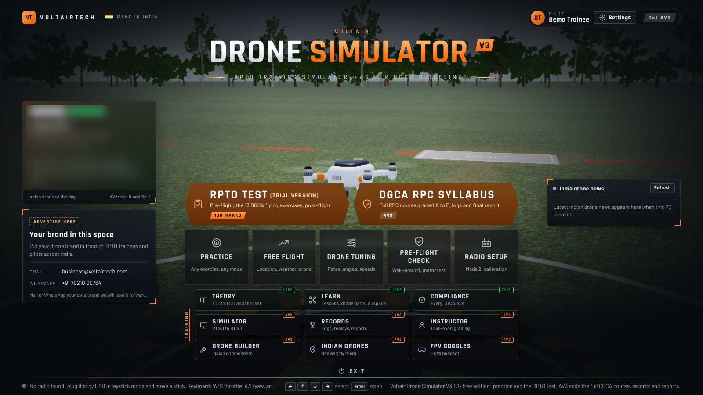

---

## Download

| Platform | File | |
|---|---|---|
| **Windows** 10 / 11 (64-bit) | `VoltairDroneSimulatorV3-Setup.exe` | [**Download**](../../releases/latest/download/VoltairDroneSimulatorV3-Setup.exe) |
| **macOS** (Apple silicon: M1 and later) | `VoltairDroneSimulatorV3-mac.dmg` | [**Download**](../../releases/latest/download/VoltairDroneSimulatorV3-mac.dmg) |

Free to install and use. **Voltair Drone Simulator AV3**, the advanced version, is bought and switched on inside the game (**Get AV3**, top right). Installing over an older V3 keeps your records, settings and licence.
V3 installs next to V2. The older version stays on the [V2.2.0 release](../../releases/tag/Drone_Trainer_V2.2.0).

---

## What it is

A drone flight simulator for **RPTO training in India**, built as per DGCA guidelines: the Remote Pilot Certificate syllabus (DTC 02 of 2022) and the simulator requirements for RPTOs (DTC 01 of 2026). Trainees practise the RPTO test and the theory. RPTOs run the full course with grades, records and reports.

## New in V3.1.1

- **Arming as on a real drone:** throttle down + yaw right for 1 second, or both sticks down and in (throttle down + yaw right, pitch down + roll left). Disarm after landing: throttle down + yaw left.
- **Throttle centre in Radio setup:** set where your radio's throttle middle is, so it reads exactly 50 % and the drone hovers at mid stick.
- **Hands-on pre-flight check:** turn each motor by hand (a worn bearing grinds and stops), spot a chipped propeller or a cracked arm, and take the top cover off with **H** to check the battery.
- **Compass calibration, four ways:** six sides (Mission Planner), horizontal then vertical turn (DJI style), free rotation (Betaflight / INAV) and Large Vehicle MagCal. Pick one, see what it needs, then do it.
- **Motor test:** each motor's spin and airflow shown next to what it should do, with Switch and Replace propeller right below.

  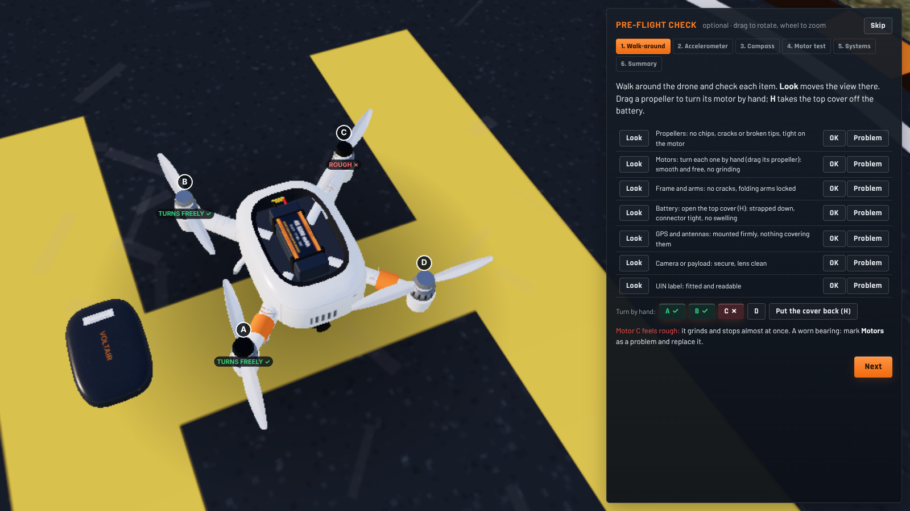
  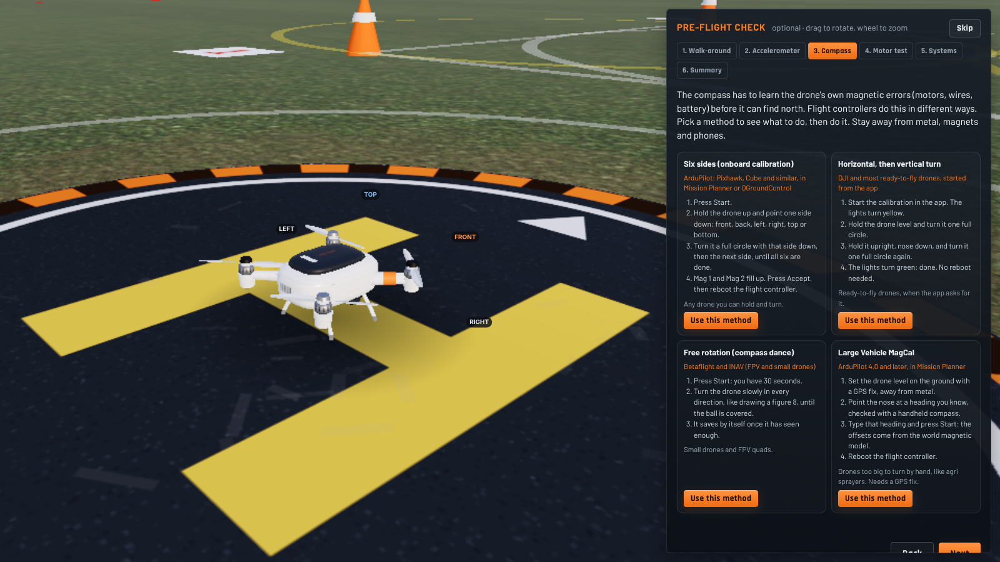

## Free vs AV3

| | Free | AV3 |
|---|:---:|:---:|
| **RPTO Test (Trial Version)** with marks: pre-flight 25 + the 13 DGCA flown exercises x 10 + post-flight 25 = **180** | ✅ | ✅ |
| Practice any of the 13 exercises, in any flight mode | ✅ | ✅ |
| **Pre-flight check**: walk-around with the motors turned by hand and the battery cover off, accelerometer, compass (four methods), motor test | ✅ | ✅ |
| **Theory T1.1 to T1.11**: lessons, quizzes and the 40-minute theory test with marks and grade A to E | ✅ | ✅ |
| Learn, DGCA compliance list, free flight, drone tuning, radio setup with throttle centre, India drone news | ✅ | ✅ |
| **Settings**: text size, screen shape for TVs and projectors, graphics level | ✅ | ✅ |
| **Full DGCA RPC course**: simulator exercises, flying exercises, Progress Check, Final Test, assembly. Every manoeuvre graded A to E | | ✅ |
| **Trainee records** kept for 5 years and sealed, with **flight log replay** (date, time, location) | | ✅ |
| **Skill test reports**, logbook, theory marks sheet, final training report | | ✅ |
| **Instructor mode**: take-over, failures, grading settings | | ✅ |
| Reference diagrams in every lesson, drone builder, Indian drones, FPV goggles | | ✅ |

In the free edition, pressing any AV3 item shows what it does before you decide.

---

## Screenshots

### RPTO Test with marks, and flying an exercise

  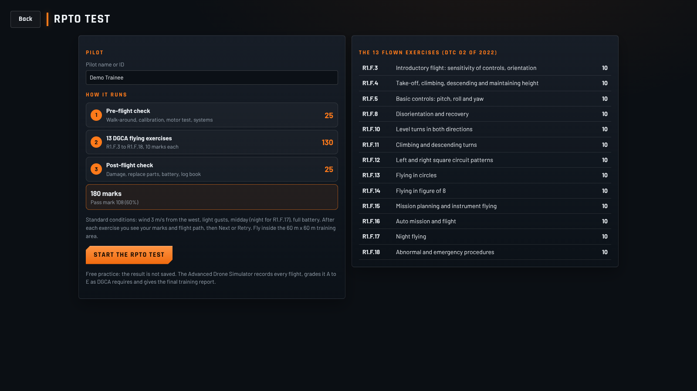
  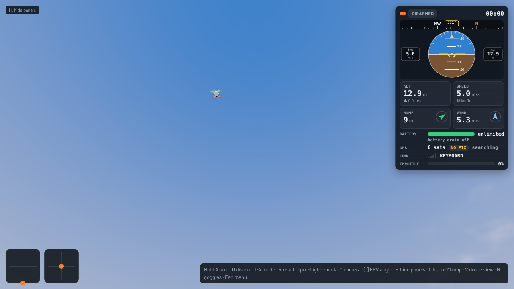

### AV3: the DGCA course, graded A to E

  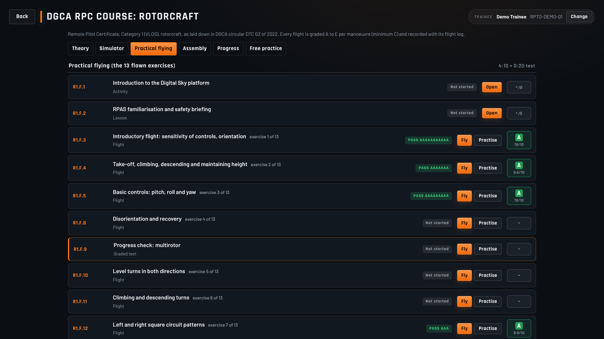
  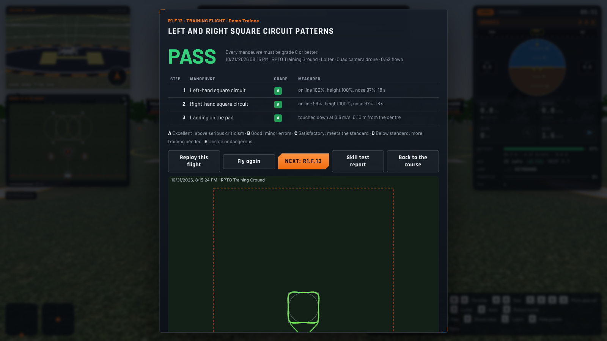

### AV3: flight log replay, and lessons with reference diagrams

  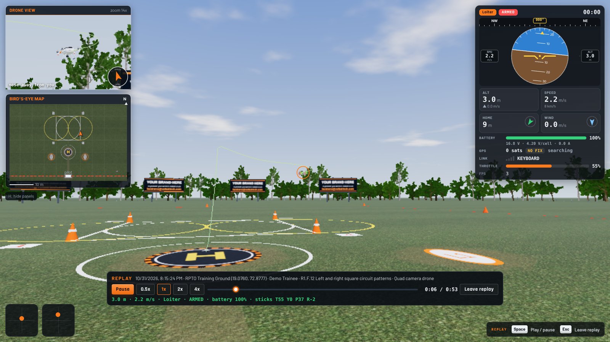
  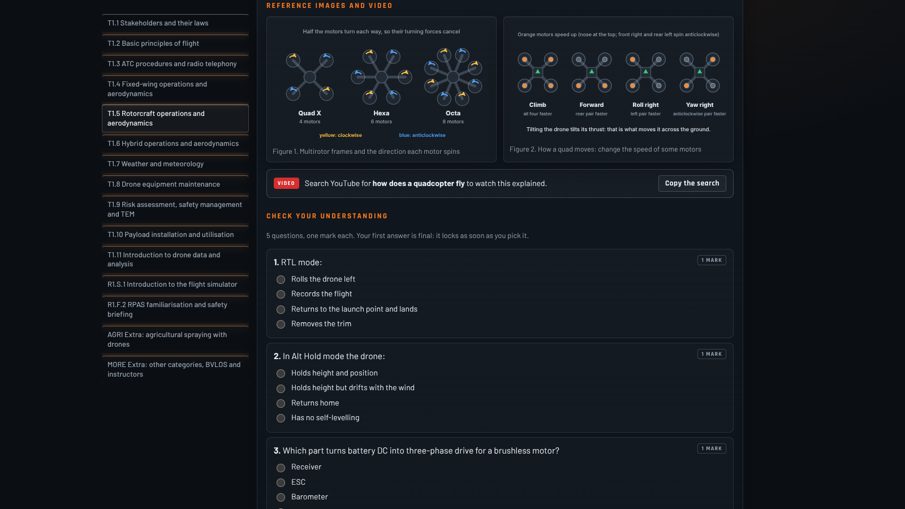

### Free edition: what AV3 adds, and display settings

  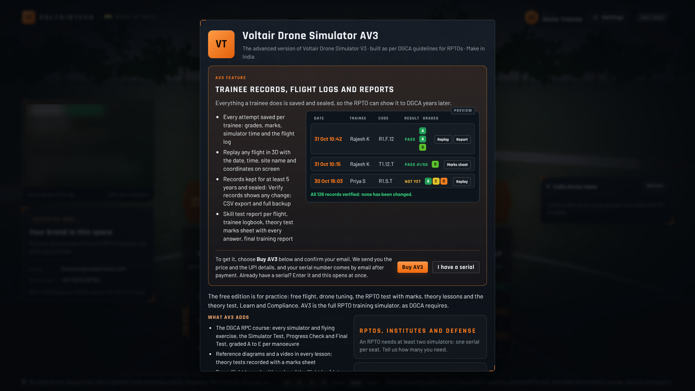
  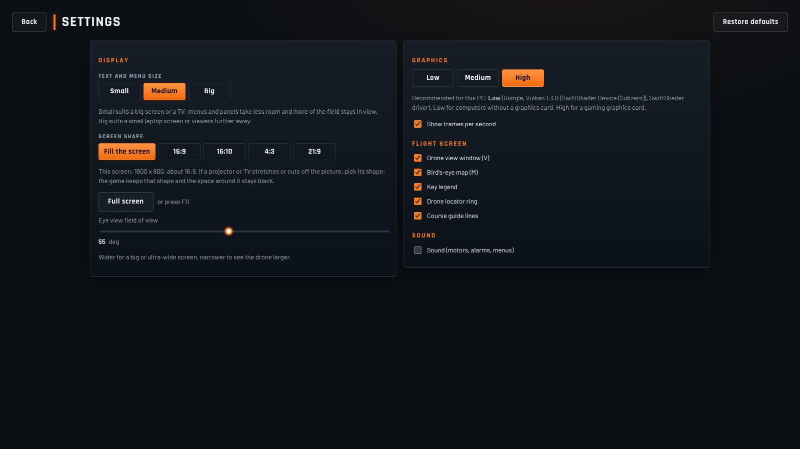

---

## Install

### Windows

1. Download `VoltairDroneSimulatorV3-Setup.exe` from [Releases](../../releases/latest) and run it.
2. If Windows SmartScreen shows a blue box, click **More info**, then **Run anyway**. The app is not yet signed with a paid certificate.
3. To update V3, close the game and run the new setup over the old one.

### macOS (Apple silicon)

1. Open `VoltairDroneSimulatorV3-mac.dmg` and drag **Voltair Drone Simulator V3** into **Applications**. Coming from Drone Trainer V3? Drag the old app to the Bin afterwards; your records stay.
2. First time only: right-click the app, choose **Open**, then **Open** again. On the newest macOS: **System Settings > Privacy & Security > Open Anyway**.

### Good to know

- Fly with the keyboard, or any RC radio, USB dongle or gamepad that the computer shows as a game controller (Mode 2).
- **Arm:** throttle down + yaw right for 1 second (keyboard: hold **D**). **Disarm:** throttle down + yaw left (keyboard: hold **A**).
- New radio? Open **Radio setup**, use Auto-setup, roll both sticks round the edge, then set the throttle centre.
- Full screen: **F11** on Windows, **Control + Command + F** on Mac.
- On a big screen or projector, open **Settings** (top right) for text size and screen shape.

---

## For RPTOs, institutes and drone brands

- **RPTOs and institutes:** DGCA asks for at least 2 simulators per batch of up to 20 trainees. AV3 is one serial per computer. For many seats, use **Get AV3 > Proposal for many PCs** in the game, or write to us.
- **Drone makers:** want your drone in the simulator? The first 5 companies go free.
- **Advertising:** the hoardings around the training ground and the home screen card are open to drone brands.

**business@voltairtech.com** · **WhatsApp +91 7021000764**

---

## About

Built by **[Voltairtech](https://voltairtech.com)**, a Make in India studio. Voltair Drone Simulator is built as per DGCA guidelines (the published RPC syllabus and RPTO simulator requirements). It is an independent training tool, not a DGCA product.

Reference Indian drones are shown as default models of the same class. We have not collaborated with those companies, and each model is updated once its maker gives permission.

**© 2026 Voltairtech. All rights reserved.** Free to download and use. Not open source: see [LICENSE](LICENSE).

