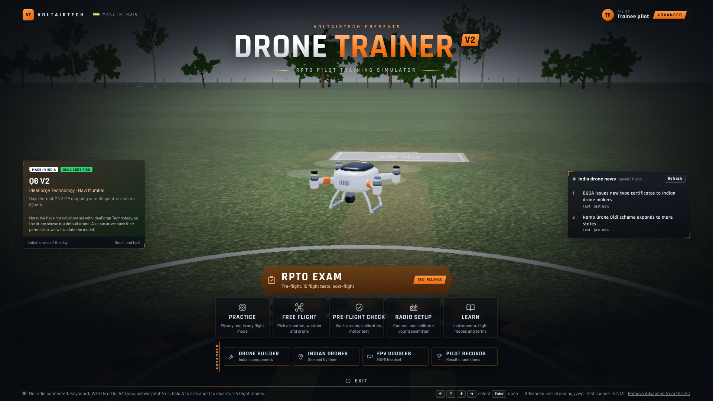
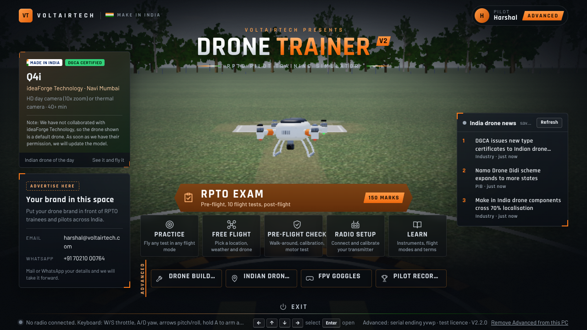
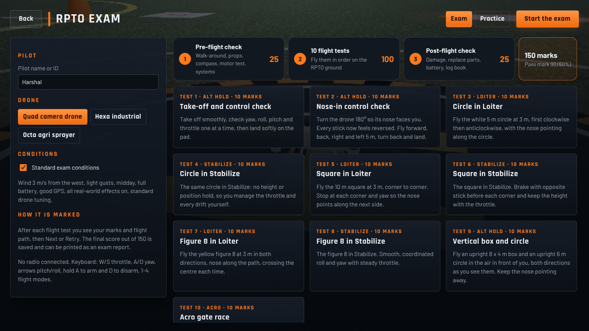
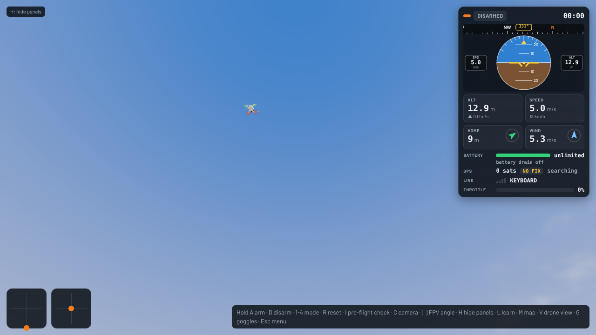
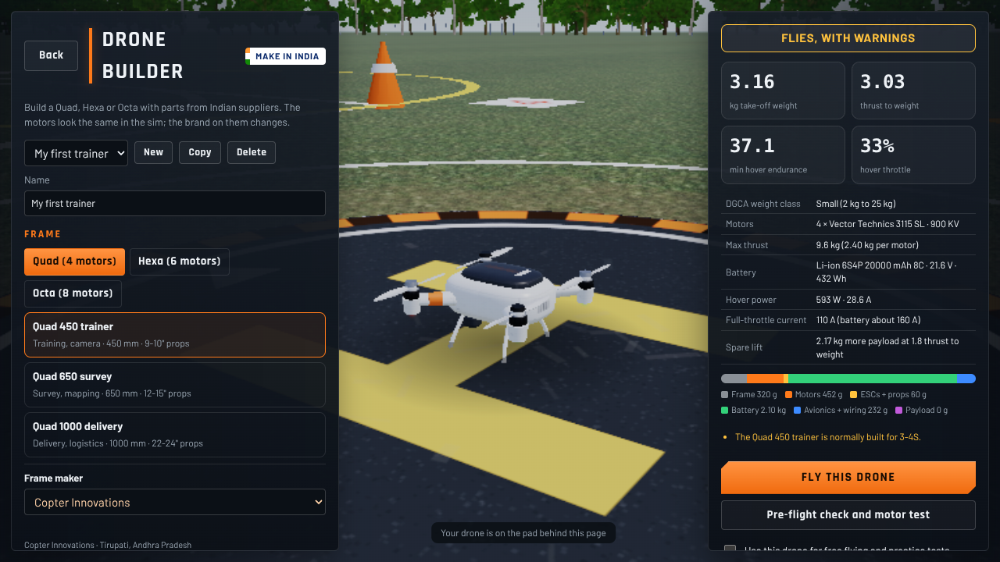
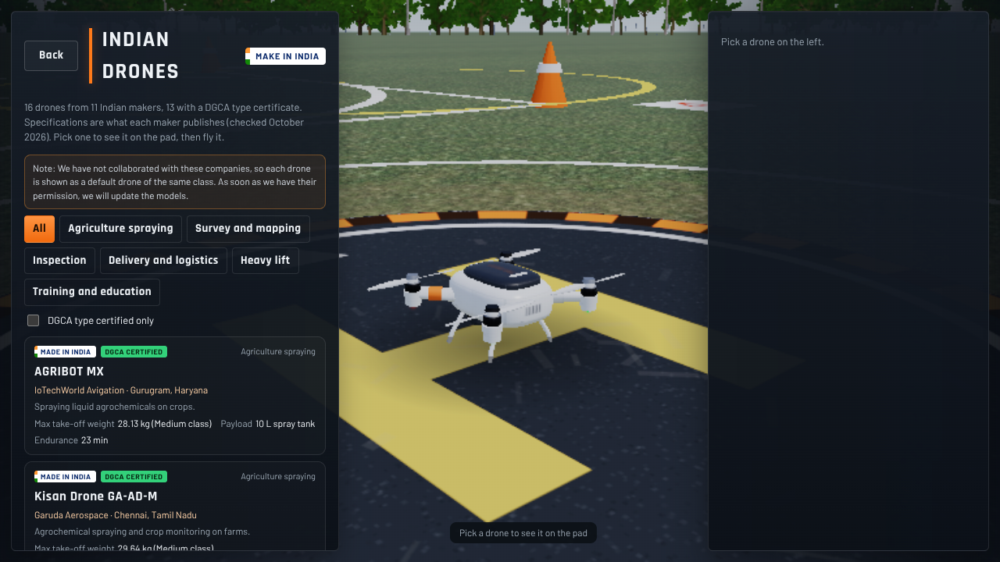
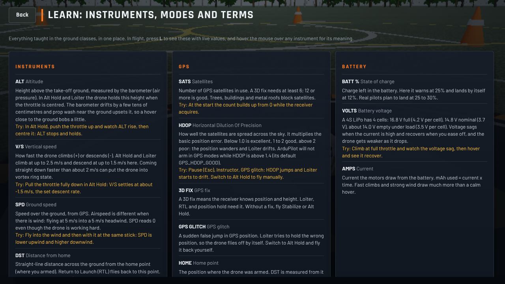
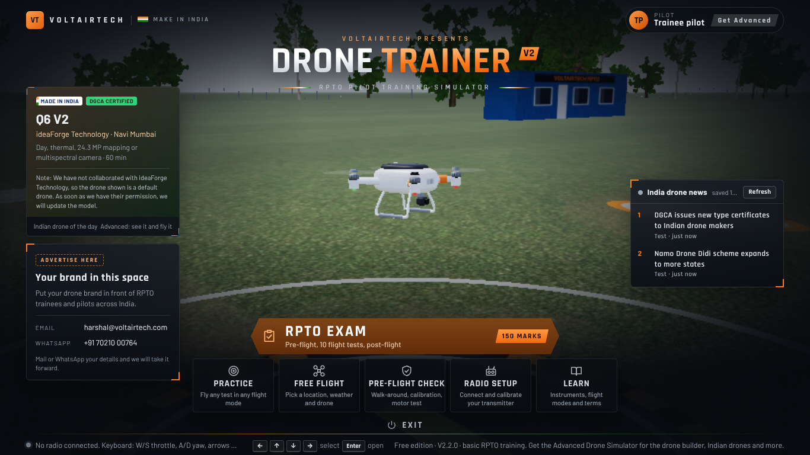
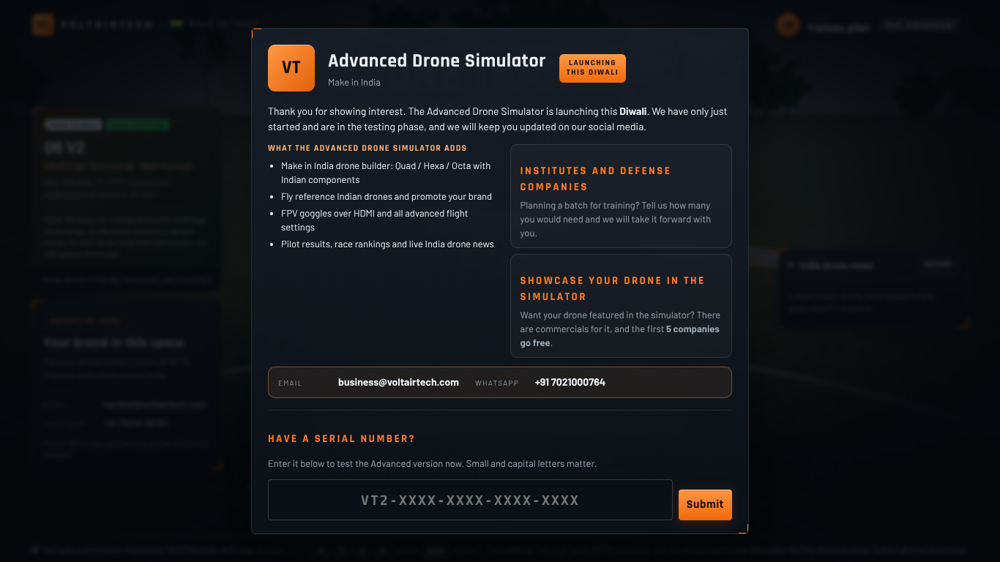

# Voltairtech Drone Trainer V2

### India's RPTO drone pilot training simulator — Make in India

---

## Download

| Platform | File | |
|---|---|---|
| **Windows** 10 / 11 (64-bit) | `DroneTrainerV2-Setup.exe` | [**Download**](../../releases/latest/download/DroneTrainerV2-Setup.exe) |
| **macOS** (Apple silicon: M1 and later) | `DroneTrainerV2-mac.dmg` | [**Download**](../../releases/latest/download/DroneTrainerV2-mac.dmg) |

All downloads are on the [**Releases**](../../releases/latest) page. The game is **free to play**. Installing needs no serial number.

---

## What it is

A flight simulator built for drone pilots training for the **DGCA RPTO** exam in India. It runs the full exam flow, free flying, the aircraft checks a pilot does before and after a flight, and a Make in India drone builder.

- **RPTO exam, scored out of 150** — pre-flight check (25) + 10 flight tests (100) + post-flight check (25).
- **Pre-flight and post-flight checks** — walk-around, accelerometer and Pixhawk-style compass calibration, motor and propeller test, DGCA log book.
- **Free flying** — pick a location, weather and drone, fly in Stabilize / Altitude-hold / Loiter / Acro modes with a realistic flight model.
- **Radio setup** — connect and calibrate a transmitter.
- **Instruments and learning** — live attitude, altitude, speed, GPS, battery and wind, with a reference section for every instrument, mode and term.
- **India drone news** — the latest drone-industry headlines on the home screen.
- Works with **keyboard** or a real **RC transmitter**, and supports **FPV goggles over HDMI**.

---

## Free vs Advanced

| | Free | Advanced Drone Simulator |
|---|---|---|
| RPTO exam (150 marks) | ✅ | ✅ |
| Pre / post flight checks, log book | ✅ | ✅ |
| Free flying, radio setup, learning | ✅ | ✅ |
| India drone news | ✅ | ✅ |
| **Make in India drone builder** | — | ✅ |
| **Reference Indian drones (fly them)** | — | ✅ |
| **FPV goggles over HDMI, advanced settings** | — | ✅ |
| **Pilot results, race rankings** | — | ✅ |

The **Advanced Drone Simulator** is unlocked with a serial number inside the game (**Get Advanced**, top right). It is **launching this Diwali** and is in testing now.

---

## Screenshots

### Home

### RPTO exam, scored out of 150

### Flight with full instruments

### Make in India drone builder

### Reference Indian drones

### Learn — instruments, modes and terms

### Free edition home, and the Advanced greeting

  
  

---

## Install

### Windows

1. Download `DroneTrainerV2-Setup.exe` from [Releases](../../releases/latest).
2. Run it, choose a folder, and it creates Start-menu and desktop shortcuts.
3. If Windows SmartScreen shows a blue box, click **More info → Run anyway** (the app is not yet signed with a paid certificate).

### macOS (Apple silicon)

1. Download `DroneTrainerV2-mac.dmg`, open it, and drag **Drone Trainer V2** into **Applications**.
2. The first time only: right-click the app and choose **Open**, then **Open** again. (On the newest macOS: **System Settings → Privacy & Security → Open Anyway**.)
3. After the first open it launches like any other app.

Full screen is **Control + Command + F** on Mac and **F11** on Windows.

---

## Advanced, institutes, defense and brands

- **Institutes and defense companies** planning a batch for training: tell us how many you need.
- **Drone makers** who want their drone featured in the simulator: there are commercials for it, and the **first 5 companies go free**.
- **Defense drones coming soon.**

Reach us at **business@voltairtech.com** or **WhatsApp +91 7021000764**.

---

## About

Built by **[Voltairtech](https://voltairtech.com)**, a Make in India studio. The simulator is an independent training tool.

The reference Indian drones and components in the builder are shown as default models of the same class; we have not collaborated with those companies, and the models will be updated as we get each maker's permission.

**Contact:** business@voltairtech.com · WhatsApp +91 7021000764

---

**© 2026 Voltairtech. All rights reserved.** Free to download and use. Not open source — see [LICENSE](LICENSE).

"# Drone_Simulator_V2" 
"# Drone_Simulator_V2" 
"# Drone_Simulator_V2" 
